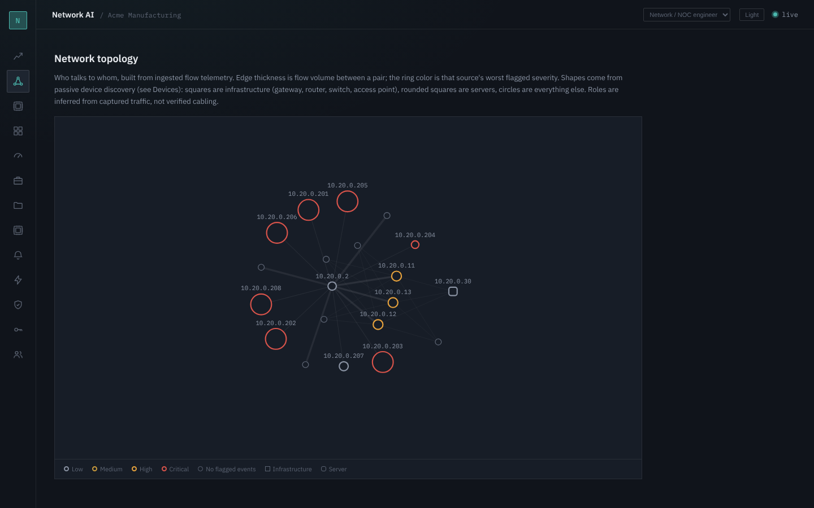
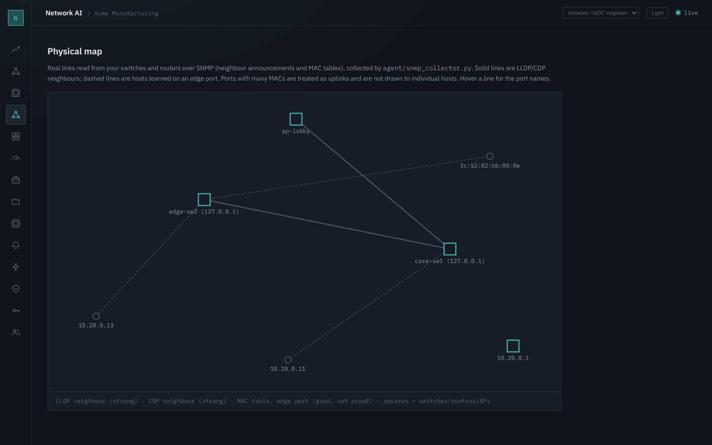
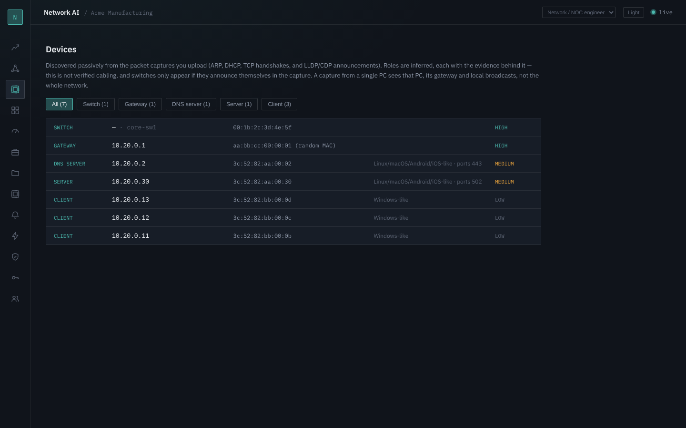
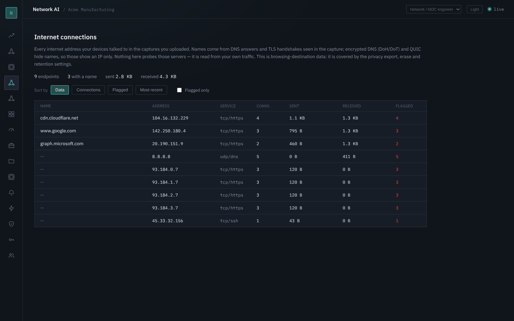

# Network AI — anomaly detection for private 4G/5G and OT networks

<https://khabibullaevmurodilla.github.io/network_ai>

A multi-tenant SaaS that ingests network flow telemetry (JSON, CSV, pcap, or a
live capture agent), scores every flow with an ensemble of four unsupervised
detectors, and shows analysts what is unusual and why. It also discovers the
network itself: devices (passively and over SNMP), physical switch links, and
the internet services a device talks to.

**Try it on your own capture (runs in your browser, nothing uploaded):** `https://khabibullaevmurodilla.github.io/network_ai/analyze/`  
**Live demo:** `https://khabibullaevmurodilla.github.io/network_ai/demo/` _(static snapshot on GitHub Pages — see [HOSTING.md](HOSTING.md); replace with your real link)_
· **Stack:** FastAPI · Supabase (Postgres + Auth + RLS) · Next.js 14 · Docker · PyOD / River



| Physical map (SNMP) | Devices | Internet connections |
|---|---|---|
|  |  |  |

_Screenshots use synthetic "Acme Manufacturing" demo data, not a real customer network._

## What it does
- **Detection:** ECOD, Isolation Forest, LOF and HalfSpaceTrees vote per flow; agreement escalates severity; per-device baselines and burst detection catch drift. New devices get a learning period before being judged (v6.8).
- **Discovery:** passive (ARP, LLDP/CDP, DHCP, DNS, TLS SNI) and SNMP (LLDP-MIB, CDP, bridge tables) device and link discovery; credentials stay on the customer side.
- **OT:** Modbus/TCP parsing with rule-based detection.
- **SaaS plumbing:** multi-tenant isolation with row-level security, API keys with scopes, roles, audit log, alert channels, incident correlation, MITRE mapping, privacy export/erase.

## Run it on your own data, with no account or keys
The `/analyze` page takes a `.pcap` / `.pcapng` capture or a flow `.csv` and analyzes it entirely in the visitor's
browser (TypeScript re-implementation of the four detectors plus pcap parsing; no upload, no backend, works on GitHub
Pages). Checked against the Python engine: ECOD and LOF scores match PyOD/scikit-learn to rounding error, Isolation
Forest agrees (rank correlation 0.98; it is random), the pcap/pcapng parser matches the Python parser field-for-field on a
87,000-packet capture, and on a labelled synthetic set it flags 94% of attacks / 1.5% of benign vs the Python engine's
92% / 2.1%. Run `cd frontend && npm run test:local` to repeat the checks. **Live capture:** run `agent/live_bridge.py` on your own computer (a web page cannot sniff packets) and connect the page to it; flows go only from that helper to your browser tab. Limits: batch mode only (fits on the uploaded
file, so no learning period, per-device baselines or burst rule), IPv4 only, files over ~30,000 flows are sampled, and it
has not been tested on real production captures.

## Database (Supabase / PostgreSQL)
`supabase/schema.sql` creates every table the backend uses (14, all with row-level security) and is safe to re-run.
CI applies it to a real PostgreSQL 16 server twice and runs `supabase/tests/schema_test.sql`: tenant A cannot read
tenant B's rows, logged-in users and visitors cannot write, bad severity/reason/role values are rejected, the
retention purge only removes data past each tenant's own window and only the backend may run it, and deleting a
tenant removes its data. **Not covered by CI:** the backend's calls through Supabase's API layer (PostgREST), Supabase
Auth and Realtime — those were exercised only on a real Supabase project during development.

## Honest status
This is a working, tested system (228 automated backend tests), not a finished commercial product.
Tested on synthetic data and on one real home capture. **Not yet validated:** detection accuracy on
real production networks, real SNMP switches/SNMPv3, and real Stripe/Slack/email delivery. Every
version section below lists exactly what was and was not verified.

## Run it
See [DEPLOY.md](DEPLOY.md) (Docker Compose, local) and [HOSTING.md](HOSTING.md) (free public hosting).
Licensed under MIT (see [LICENSE](LICENSE)).

---

# Network AI — Anomaly Detection SaaS

Multi-tenant AI anomaly detection for private 4G/5G and OT networks. Built on
the validated detection engine (PyOD ECOD + Isolation Forest, 100% detection
on 7/8 attack types, 82% on HTTP flood, 0.24% false-positive rate — see
`/network-ai-demo/DEMO_REPORT.md` from the earlier standalone demo).

## What's real vs. what's a stub

**Fully built and tested:**
- Detection engine (`backend/app/ml/engine.py`) — refactored from the one-off
  demo script into a live, per-tenant scoring service. Verified working on
  synthetic test flows in this session (flood-shaped traffic correctly flagged,
  normal traffic correctly passed).
- FastAPI backend — all routes verified to register and respond (`/health`
  returns 200, OpenAPI schema confirms all endpoints, including API-key
  list/revoke added alongside create). Multi-tenant via Supabase RLS +
  API-key/JWT auth, both implemented.
- Next.js frontend — builds cleanly (`npm run build` succeeds, all 5 pages
  compile and prerender). Visual design pass done: dark console UI
  (self-hosted IBM Plex Sans/Mono, no Google Fonts dependency), a signal-trace
  hero chart, instrument tiles, and an event log for flagged anomalies —
  across sign-in, overview, and settings/API-keys pages. Connects to the
  real `/dashboard/summary` and `/dashboard/anomalies/recent` endpoints, and
  fails visibly (not silently) when the backend isn't reachable.
- Supabase schema — tenants, profiles, api_keys, telemetry_flows,
  anomaly_events, subscriptions, with RLS policies so one tenant can never
  read another's data.

**Stubbed, needs your credentials before it does anything:**
- Supabase project doesn't exist yet — you need to create one and run
  `supabase/schema.sql`.
- Stripe products/prices aren't created — billing.py will return a clear
  error ("Plan not configured") until `STRIPE_PRICE_STARTER` /
  `STRIPE_PRICE_PRO` env vars point at real Stripe Price IDs.
- No real telemetry source connected yet — ingestion endpoints work, but
  nothing is POSTing to them until a pilot partner's agent (or a CSV export)
  is wired up.
- Signup flow — login page exists; a matching `/signup` page + the
  tenant-creation logic (new Supabase Auth user → new `tenants` row → new
  `profiles` row linking them) still needs to be written. Noted, not built.

**Known architectural limitation, not hidden:** per-tenant detectors are
held in memory per backend process (`DetectorRegistry` in `engine.py`). Fine
for a single instance; needs to move to persisted model state (pickled to
Supabase Storage, or a model-serving layer) before running multiple backend
instances behind a load balancer. Flagged as a scale TODO.

## Security & privacy posture (v3)

Built in response to "this is a network product, it needs to be the most
secure and private, with competitive dashboard features." Verified in
isolation (unit tests, route checks, hand-built test flows) — not yet run
end-to-end against a live Supabase project.

**Backend lockdown**
- CORS is fail-closed: an unset `ALLOWED_ORIGINS` means *zero* browser
  origins are allowed, not `"*"`. You must explicitly list your frontend's
  domain in production.
- Rate limiting (`slowapi`) on both ingest endpoints, keyed by API key (or
  client IP if none), default `120/minute`, configurable via
  `INGEST_RATE_LIMIT`.
- API keys are scoped (`ingest` / `read` / `admin`) and enforced per-route —
  an `ingest`-scoped key physically cannot call a read or admin endpoint.
  Raw key material is never stored, only a SHA-256 hash; `last_used_at` is
  stamped on every use so you can spot a dead or compromised key.
- Append-only audit log: every security-relevant action (ingestion, key
  creation/revocation, webhook changes, data export, erasure) is logged.
  Row-Level Security gives tenant admins read access to their own log but
  **no insert/update/delete policy at all** — only the backend's
  service-role connection can write to it, so even a compromised admin
  session can't tamper with the trail.

**Data handling & minimization**
- `telemetry_flows.src_ip`/`dst_ip` are optional — you can ingest without
  ever sending IPs if your privacy posture requires it; entity grouping
  just falls back to "unidentified".
- Per-tenant data retention (`tenants.data_retention_days`, default 90) and
  a `purge_expired_telemetry()` Postgres function that deletes flows past
  that window. **Gap, disclosed:** this function exists but isn't scheduled
  yet — wire it to Supabase's `pg_cron` extension or an external cron hitting
  a backend endpoint before relying on it.
- Encryption: Supabase encrypts data at rest and all connections are TLS by
  default — this is a property of the platform, not something this codebase
  adds. We haven't layered on application-level field encryption; if that's
  a hard requirement for your target customers (it often is for OT/critical
  infrastructure buyers), that's the next thing to scope.
- GDPR-style rights are real, not cosmetic: `GET /privacy/export` returns
  every row belonging to the tenant; `DELETE /privacy/erase` is a genuine
  cascading delete (telemetry → anomalies → keys → webhooks → audit log →
  tenant row itself), not a soft-delete flag.

**Access control**
- Two separate auth paths: JWT (Supabase Auth, human dashboard users) and
  scoped API keys (machine telemetry agents). Admin-only actions
  (key/webhook management, privacy export/erasure) require an `admin`-role
  profile, enforced server-side on every call, not just hidden in the UI.
- **Gap, disclosed:** session controls (token expiry, MFA, device limits)
  currently run on Supabase Auth's defaults — nothing custom has been
  configured or documented yet.

## v4 — advanced detection, SOC workflow, enterprise, real-time

Built in response to "make it more advanced" across all four axes raised.
Verified the same way as v3: unit tests on the engine, route/auth checks,
a clean frontend build, and a hand-crafted-data SSE round-trip test — not
yet a live end-to-end run against a real Supabase project.

**Detection engine**
- Third detector added: Local Outlier Factor (LOF), alongside ECOD and
  Isolation Forest. Each catches a different attack shape (distributional
  extremes / isolable points / local density), so a flow all three agree
  on is a much stronger signal than any one score. `consensus_count`
  (0-3) is now on every event.
- Ensemble consensus escalation: 2+ detectors agreeing promotes a flow
  ECOD's own percentile missed (to "low"), or escalates one already
  flagged by a full tier. Verified: a mild anomaly scored "low" by ECOD
  alone came back "low" with `consensus_count: 2` when IForest/LOF agreed,
  and a flood-shaped flow where all three agreed escalated from "high" to
  "critical".
- Entity burst detection: a sliding per-source-IP window tracks flagged
  events; 5+ within 60 seconds forces "critical" regardless of individual
  severity — the "low-and-slow" pattern a single-flow score alone misses.
  Verified directly: four "low" events from one source stayed low, the
  5th escalated to "critical" with `escalation_reason: "entity_burst"`.
- Adaptive thresholds: severity cut points are no longer frozen at fit
  time. A rolling window of live scores (seeded from the training
  distribution) is recomputed every 100 flows, so the baseline drifts
  with the tenant's actual traffic.
- **Honestly scoped:** this is ensemble + adaptive-threshold + rule-based
  burst detection, not sequence/deep-learning modeling (no LSTM/
  transformer). It's a real, verified improvement over single-detector
  scoring, not the heavier "time-series modeling" some competitors market
  — flagged here so it isn't overclaimed.

**SOC investigation workflow**
- Event detail page (`/dashboard/anomalies/[id]`): per-detector scores
  (ECOD/IForest/LOF, flagged or not), the explanation breakdown, the raw
  flow record, and why it was escalated — everything needed to decide if
  an alert is real without leaving the page.
- Alert triage: new → acknowledged → resolved, enforced server-side
  (analyst role or higher), logged to the audit trail.
- Entity detail page (`/dashboard/entities/[source]`): every flagged
  event from one source, linked from the entities list.
- Trend chart on the overview page: daily flagged-event counts stacked by
  severity over the last 14 days.

**Enterprise readiness** — see `ENTERPRISE.md` for the full breakdown.
Short version: a real 4-tier RBAC model (viewer/analyst/admin/owner)
enforced on every route; SSO is a genuinely supported path through
Supabase Auth but needs a customer's IdP and a role-mapping function that
doesn't exist yet; a SOC2-style control-mapping table that's honest about
what's implemented (access control, audit log, RLS isolation) vs. not
(scheduled retention purging, uptime monitoring, incident-response
runbook, pen testing); and a stated SLA posture of "none yet," with the
concrete steps to get a credible first tier.

**Real-time pipeline**
- `/dashboard/stream` (Server-Sent Events): the dashboard gets newly
  flagged anomalies pushed the moment `ingest.py` scores them, instead of
  polling. Verified with a direct pub-sub test (publish → subscriber
  receives within the same event loop tick) and confirmed the frontend's
  live indicator and event-log auto-append work against mocked data.
- **Scale caveat, stated plainly:** the event bus is in-process, same
  limitation as `DetectorRegistry`'s in-memory model state — it only
  reaches subscribers connected to the same backend instance that
  received the ingest call. Needs Redis pub/sub (or Supabase Realtime)
  before running multiple backend instances behind a load balancer.

## v5 — online learning, incident correlation, distributed real-time, response hooks

Built in response to "go more advanced," scoped specifically against the
four things v4 had flagged as gaps: real online learning (not just a
cold-start bootstrap), a grouped view of related alerts instead of a flat
list, the SSE bus's single-instance limitation, and detection that only
notifies rather than acting. Verified the same way as prior rounds —
including, this round, against a real local Redis instance, not just a
mocked one.

**True online learning**
- Added River's HalfSpaceTrees as a 4th ensemble member — the only
  detector of the four that is actually learning online in the literal
  sense (scores a flow, then updates on it, one at a time, no refit step
  ever). ECOD/IForest/LOF are still batch learners re-fit at bootstrap/on
  `refit_on_real()`; that's now stated precisely rather than lumped
  together.
- Consensus is now out of 4 detectors: 2+ promotes a flow the others
  missed, 3/4 escalates a tier, full 4/4 agreement escalates two tiers at
  once. Verified: a flood-shaped flow got 4/4 consensus and escalated
  straight to critical.
- Per-entity behavioral baseline (Welford's online algorithm): each source
  IP gets its own running mean/variance, independent of the tenant-wide
  model. A flow that looks unremarkable tenant-wide but is a 5+ sigma
  departure from *that specific host's* own history gets flagged with its
  own `entity_baseline_drift` reason. Verified directly: a host with a
  very consistent 25-flow baseline got flagged "medium" the moment one
  field (`src_bytes`) jumped 4x, even though tenant-wide consensus alone
  was only 1/4 — the per-asset view caught something the global ensemble
  underweighted.

**Incident correlation** (`core/incidents.py`, `/dashboard/incidents`)
- Flagged events from the same source within a 30-minute rolling window
  correlate into one open incident instead of standing as separate alerts
  — "47 alerts from one host" becomes "1 incident, 47 events, still open."
  Verified with a scripted multi-batch test: two events from one source
  landed in the same incident; a third from a different source got its
  own; a later batch from the first source reused the still-open incident
  and bumped its severity and event count correctly.
- **Honestly scoped:** correlation is same-source-IP-within-a-time-window,
  not multi-entity attack-chain reconstruction (lateral movement across
  hosts, say) — a real, useful first heuristic, not a claim of anything
  more sophisticated.

**Distributed real-time** (`core/stream.py`)
- The SSE event bus now has a Redis-backed mode, selected automatically
  when `REDIS_URL` is set, with the in-memory bus (v4) as the default
  fallback when it isn't. This is the piece that actually lets more than
  one backend instance share live events — v4's bus only reached
  subscribers on the same process that handled ingestion.
- Verified against a **real local Redis instance** in this session, not a
  mock: two independent `RedisEventBus` clients, simulating two separate
  backend processes, confirmed an event published by one was received by
  a subscriber on the other via the shared channel.
- **Honestly scoped:** this closes the gap for the event bus specifically.
  The detector/model state in `ml/engine.py` (`DetectorRegistry`,
  adaptive thresholds, burst tracking, entity baselines) is still
  in-process-only — flagged explicitly in that file's own docstring as
  the next piece of the same work, not folded into "real-time is now
  distributed" as if it covered everything.

**Automated response hooks** (`core/response_actions.py`, `/response-actions`)
- Distinct from the v3 notify-webhooks: a response action sends the
  tenant's own firewall/NAC/SOAR platform a signed, structured directive
  (`webhook_block` or `webhook_notify_soar`) when a configured trigger
  fires (critical severity, entity burst, baseline drift, or ensemble
  consensus), instead of just telling a human to go look.
- **Scoped honestly, stated in the UI itself, not just this file:** this
  product has no firewall, NAC, or network enforcement point of its own
  and cannot block traffic directly. What it sends is a verifiable
  HMAC-signed instruction; the customer's own systems decide what to do
  with it. Every dispatch attempt (sent or failed) is written to the audit
  log so "did we actually tell the firewall to block this?" has an answer.

## v6 — distributed detector state, real pcap ingestion, production hardening, deployment package

The honest gap list at the end of v5 was: no live deployment, detector
state still single-instance-only even with the Redis event bus, no real
network data had ever been fed through the engine, and no deployment
package existed for someone else to actually run this. v6 closes each of
those as far as they can be closed without a live customer environment.

**Cross-instance detector-state checkpointing** (`ml/persistence.py`)
- v5 left this explicitly unsolved: the fitted ECOD/IForest/LOF models,
  the HalfSpaceTrees online model, adaptive thresholds, entity burst
  windows, and per-entity Welford baselines all lived in one process's
  memory only.
- Every `CHECKPOINT_EVERY_FLOWS` (500) flows, a tenant's full detector
  state is pickled and written to Redis with a TTL. On a cache miss (a
  tenant this process hasn't scored yet), the registry checks Redis for a
  recent checkpoint before cold-bootstrapping on synthetic data again.
- **Verified against a real local Redis**, not mocked: two independent
  `DetectorRegistry` instances (simulating two backend processes) — the
  second instance picked up the first's entity baselines and severity
  cuts exactly, confirmed field-by-field.
- **Scoped honestly**: this is checkpoint-based recovery and warm-start,
  not live per-flow replication across concurrent writers. True per-flow
  consistency needs sticky routing (same tenant always hits the same
  instance between checkpoints) — a load-balancer configuration concern,
  documented in `DEPLOY.md`, not something application code alone can
  solve. Said plainly in `ml/persistence.py`'s own docstring too.

**Real pcap ingestion** (`ingestion/pcap.py`, `POST /ingest/pcap`)
- Parses an actual `.pcap`/`.pcapng` capture file into the same flow-record
  schema the engine scores — bidirectional flow aggregation by 5-tuple,
  standard FIN/RST/inactivity-timeout flow closing (NetFlow/Argus-style
  rules, not invented here).
- **Verified against a real captured pcap**, not synthetic bytes: captured
  539 real packets of real loopback TCP traffic with `tcpdump`, parsed
  them into 162 flows, scored them through the actual detection engine
  end-to-end, and confirmed the whole `POST /ingest/pcap` HTTP path works
  (parsing → scoring → incident correlation → DB writes) via a full
  FastAPI `TestClient` request.
- **A real bug was caught and fixed during this verification**: the
  initial flow-close logic ended a TCP flow on the first FIN seen from
  *either* side, truncating a normal two-way close and fabricating a
  spurious second flow from the other side's FIN/ACK. Loopback-only
  testing couldn't surface this (both "sides" share one IP); a
  constructed test with distinct source/destination IPs caught it
  immediately. Fixed to require FIN from both directions (or an
  immediate-close RST), and a regression test (`tests/test_pcap.py`)
  pins the fix.
- **Scoped honestly**: this ingests a capture file someone hands over (a
  SPAN-port dump, a pilot partner's export). A live packet-tap agent that
  captures and streams this automatically is a separate piece of work —
  see v6.1 below, where that agent is actually built.

**Production hardening**
- Liveness (`GET /health`, never touches a dependency) vs. readiness
  (`GET /health/ready`, pings Supabase and Redis with a 2s timeout each,
  returns a real HTTP 503 when not ready — not just a string in the
  body) are now properly separated, the distinction a real load
  balancer/orchestrator actually needs.
- Structured JSON logging (`core/logging_config.py`) replaces default
  Python log formatting, so logs are actually machine-parseable.
- A top-level exception handler sanitizes every unhandled error: full
  detail goes to the structured logs, the HTTP response gets a generic
  message with no stack trace, exception class name, or internal detail.
  **A real finding from testing this**: the readiness check was
  initially echoing raw exception text (which can embed connection
  strings or credential fragments) straight into its — unauthenticated —
  response. Fixed to log full detail server-side only; a test
  (`tests/test_health.py`) pins that no internal detail reaches the
  client, including via a simulated exception containing a fake
  credential string.
- `POST /ingest/pcap` enforces a 150MB upload cap, independent of and in
  addition to the existing per-key rate limit.
- **Stripe webhook signature verification re-verified with real
  cryptography**, not a mock: generated an actual signed payload the way
  Stripe itself would (`stripe.WebhookSignature.generate_signature_header`),
  confirmed a valid signature is accepted and correctly updates tenant
  state, and confirmed a tampered payload, a missing signature header,
  and a forged signature are all rejected with 400.
- Already in place from earlier versions and re-confirmed here, not
  newly built: per-API-key rate limiting, CORS that fails closed with no
  wildcard default, SHA-256-hashed/scoped/revocable API keys, 4-tier
  RBAC, append-only audit logging, and no raw SQL anywhere (every DB
  access goes through the Supabase query builder).
- `frontend/package.json`'s `next` dependency was bumped from `14.2.15`
  to `14.2.35` (latest available 14.x patch). `npm audit` still flags one
  remaining critical/high pair, fixed only in Next 15/16 — the specific
  vulnerable surfaces (Server Actions, `next/image`, custom middleware,
  i18n routing) are confirmed absent from this codebase by grep, but this
  is flagged as a real, tracked follow-up in `DEPLOY.md`, not hidden.

**A real automated test suite** (`backend/tests/`, run in CI)
- 19 pytest tests (now 36 as of v6.1, see below) replace what were
  previously one-off verification scripts: detection-engine behavior
  (quiet on normal traffic, critical on an obvious flood, entity-baseline
  drift detection, checkpoint pickling), real pcap parsing (including the
  FIN/RST bug above, pinned as a regression test), real Stripe signature
  verification, and the health-check contract (liveness/readiness status
  codes, no internal leakage).

**Deployment package** (`Dockerfile`s, `docker-compose.yml`,
`.github/workflows/ci.yml`, `DEPLOY.md`)
- Multi-stage Dockerfiles for both services (non-root user, healthcheck,
  Next.js `output: "standalone"` for a lean frontend image).
- `docker-compose.yml` wires backend + frontend + a self-hosted Redis for
  a single-host deploy; Supabase stays an external managed service (not
  something this stack self-hosts).
- GitHub Actions CI runs the full backend test suite, an app-import
  sanity check, and the frontend's typecheck + production build on every
  push/PR.
- **Scoped honestly — read before trusting this**: the sandbox this was
  built in blocks every container registry it tried (Docker Hub, AWS ECR
  Public, Microsoft Container Registry, GHCR), so a full
  `docker build && docker run` could not be executed end-to-end here.
  What WAS verified: both Dockerfiles parse correctly and fail only at
  the external image pull (confirming no syntax/stage errors), the
  frontend's standalone build output was generated and inspected
  directly, and `docker compose config` validated the compose file's
  service wiring and variable substitution. The actual multi-container
  boot needs to be tried once in an environment with normal registry
  access — `DEPLOY.md` says this explicitly rather than claiming a
  verification that didn't happen.
- `DEPLOY.md` walks through Supabase project setup, optional Redis,
  optional Stripe, environment variables, and both a single-host
  Docker Compose path and a multi-instance/platform path (with the
  sticky-routing recommendation for true cross-instance state
  consistency, since Redis checkpointing alone gives recovery, not live
  replication).

**What's still genuinely not done, stated plainly:**
- No live deployment has actually happened — everything above was
  verified locally/against real-but-self-provisioned infrastructure
  (a local Redis, a locally captured pcap, a locally-run FastAPI test
  client). No real Supabase project, no real customer traffic, no actual
  internet-facing instance exists yet.
- No multi-entity attack-chain reconstruction — incident correlation is
  still same-source-IP, time-windowed grouping, not a graph of related
  entities across a multi-stage attack.
- `next` is on a patched 14.x, not the 15/16 line the remaining `npm
  audit` findings need to fully clear.

## v6.1 — live capture agent, Modbus/TCP OT protocol support

v6 explicitly left two things undone: no live packet-tap agent (pcap
ingestion needed someone to hand over a capture file by hand), and no
understanding of OT/ICS protocol traffic at all — every byte on the wire
was just flow-level IP statistics, regardless of what industrial protocol
it actually carried. v6.1 builds both.

**Live capture agent** (`agent/network_ai_agent.py`)
- A standalone Python script, meant to run at a customer's network edge
  (a SPAN/mirror port, a tap), not inside this repo's backend/frontend
  services. Captures fixed-duration windows with `tcpdump` as a
  subprocess (BPF filter support, e.g. restrict to port 502 for
  Modbus-only capture), then POSTs each window's pcap straight to
  `POST /ingest/pcap` with retry/backoff on transient failures and a
  longer backoff specifically on HTTP 429 (rate limiting).
- **Verified against a really-running backend over real HTTP** — not
  `TestClient` — via `uvicorn.run()` in a background process and the
  agent's actual `requests` calls hitting it on a real port.
- **Two real bugs caught and fixed during adversarial testing**, not
  found by inspection: (1) a capture window that failed outright (bad
  interface, no permissions) never incremented the window counter,
  so `--max-windows` was silently ignored and the agent ran forever on a
  persistently broken capture; (2) `SIGINT`/`SIGTERM` sent mid-window
  didn't actually stop the process until that window's full duration
  elapsed, because the shutdown check only ran between windows, not
  during one. Both are fixed (confirmed via `pgrep`/`kill -0` after
  sending the signal) and pinned by `agent/tests/test_agent.py` (5 tests,
  run in CI as a separate `agent` job).
- **Scoped honestly**: needs `CAP_NET_RAW`/`CAP_NET_ADMIN` (or root) to
  capture; the included systemd unit and README show the
  `setcap`-on-`tcpdump` approach so the agent process itself doesn't need
  to run as root. Captures full packets within its BPF filter — doesn't
  itself redact anything, so filter and retention policy are the
  operator's responsibility (see `agent/README.md`).

**Modbus/TCP protocol parsing and OT anomaly detection**
(`ingestion/modbus.py`, `ml/ot_rules.py`, `POST /ingest/pcap`)
- Modbus/TCP is the most common industrial protocol still in service
  (no auth, no encryption, minimal framing) — the obvious first OT
  protocol to actually parse rather than just see as opaque bytes. Every
  `POST /ingest/pcap` capture is now *also* scanned for Modbus/TCP
  messages (MBAP header + PDU, function codes, read/write
  addresses/quantities, exception responses) independently of the
  existing flow-level scoring — a capture with no Modbus traffic simply
  yields zero OT events and never blocks the flow-level path.
- A **deterministic, allowlist-style rule engine** evaluates each
  message — deliberately *not* the statistical ML ensemble used for IT
  flow traffic. This is a considered choice, not a shortcut: industrial
  control traffic is highly deterministic (a given PLC talks to a given
  address/function-code set, essentially forever), so "this device just
  got written to at an address nothing has ever written to before" is a
  sentence a control engineer can act on immediately, where an opaque
  anomaly score isn't. Four rules, each independently triggerable: a new
  function code for a device pair after baseline, a write to a
  never-before-seen address (the strongest signal — this is the shape
  real ICS sabotage takes), an exception-response flood (scan/probe
  shape), and one source querying many distinct unit IDs in a short
  window (enumeration shape, the Modbus analogue of a port scan).
- **Verified with real constructed packets** (dpkt-built, not hand-typed
  byte arrays) covering read/write/exception message shapes, and against
  **4 realistic scenarios** for the rule engine: baseline establishment
  with zero false positives, a write to a new address correctly taking
  priority over the weaker new-function-code rule when both would fire,
  exception-flood severity escalating to critical, unit-ID-scan
  detection, and — the core trust guarantee — confirmed no false
  positive on legitimate repeated writes to an already-known address.
  **Then verified fully end-to-end**: a real pcap posted over real HTTP
  to a really-running backend, parsed, scored, stored, and correctly
  surfaced in the API response (`{"ot": {"ingested": 13, "flagged": 1}}`)
  alongside the unaffected flow-level result in the same request.
- New `ot_protocol_events` table (own schema, own RLS policy, own
  retention purge) and a new `GET /dashboard/ot-events/recent` endpoint;
  flagged OT events correlate into the same `incidents` table flow-level
  anomalies do. A new **OT protocol events** dashboard page lists them
  with severity, device pair, function, address, and the specific rule
  reason, with a toggle between "flagged only" and "all messages".
- **Scoped honestly**: decodes the common read/write function codes
  (1,2,3,4,5,6,15,16) with full address/quantity extraction; less common
  ones are recorded by name but not decoded further. This is Modbus/TCP
  specifically — not Modbus/RTU-over-serial, not other OT protocols
  (DNP3, IEC 61850/GOOSE, OPC-UA, Profinet), each of which would need
  its own parser module. No TCP stream reassembly — assumes one Modbus
  ADU per TCP segment, true for the overwhelming majority of real
  Modbus/TCP traffic but not a message split across segments. OT rule
  baselines, like the ML engine's entity baselines, live in process
  memory only; the same Redis-checkpointing story from v6 hasn't been
  extended to cover them in this pass.

**Test suite grew accordingly**: 17 new tests (`test_modbus.py`,
`test_ot_rules.py`) bring the backend suite to 36, plus the agent's own 5
— all pass, run in CI.

**What's still genuinely not done, stated plainly:**
- No live deployment of the agent at a real network edge — verified
  against a real local interface/capture and a real running backend in
  this sandbox, not against a customer's actual SPAN port.
- Only Modbus/TCP is understood at the protocol level; other OT
  protocols (DNP3, IEC 61850, OPC-UA, Profinet) are still just flow-level
  bytes to this system.
- OT rule-engine baselines aren't checkpointed across instances yet
  (same gap v6 solved for the ML engine, not yet extended here).

## v6.2 — adversarial security review

Prompted by a direct ask to stress-test the product end to end, from basic
correctness up through "high level security and interactions," ahead of
pitching it broadly. This was a real adversarial pass against the running
app (TestClient against the actual FastAPI app, real JWT forgery, real
cross-tenant state, real HTTP bursts) organized around eight categories:
auth/authz, multi-tenant isolation, injection/fuzzing, webhook/signature
forgery, rate limiting/DoS, business-logic edge cases, transport/headers,
and a final compile-and-fix pass. **9 real, confirmed bugs were found and
fixed**, each with a regression test that reproduces the original failure.
Nothing below is a hypothetical "could theoretically" finding — every one
was triggered against the real code before being fixed.

**Confirmed and fixed:**
1. **SSRF via webhook/response-action target URLs** (`core/url_safety.py`,
   new) — a tenant admin's `target_url`/webhook `url` was sent server-side
   with zero validation: pointed at `169.254.169.254` (cloud metadata),
   `127.0.0.1`, or an internal service, this backend would make that
   request on an admin's behalf. Fixed with two layers: creation-time
   rejection of private/loopback/link-local/reserved addresses and
   non-http(s) schemes, *and* dispatch-time re-resolution right before
   each actual request (closes the DNS-rebinding gap creation-time
   validation alone can't — a hostname can resolve safely at creation and
   be repointed to an internal IP by the time of real dispatch).
2. **JWT missing `sub` claim crashed into an unhandled 500** instead of a
   clean 401 (`core/auth.py`) — an unguarded `payload["sub"]` dict access.
   Also hardened: `exp` and `sub` are now both *required* claims (PyJWT
   only validates `exp` if present, so a token forged without one — only
   possible if the signing secret itself leaked, but still worth closing
   — would otherwise never expire).
3. **`/privacy/export` and `/privacy/erase` were missing three tables
   entirely** (`incidents`, `response_actions`, `ot_protocol_events`) from
   `TENANT_SCOPED_TABLES` — added across v5/v6.1 but never added here. A
   tenant requesting "everything we hold about you" would not have
   received their incidents or OT events; erasure happened to still work
   via the schema's FK cascade, but that was an undocumented accident, not
   something the code was actually asserting.
4. **Malformed CSV upload crashed into an unhandled 500** — a missing
   required column or a non-numeric value in a numeric column (confirmed
   via direct reproduction: `ValueError: could not convert string to
   float`) flowed straight into the ML scoring pipeline. Now validated and
   rejected with a clean, specific 400 before scoring ever runs.
5. **No size/row cap on the CSV or JSON batch ingestion paths** — unlike
   `/ingest/pcap`'s existing 150MB cap, `/ingest/csv` had no size limit at
   all and `/ingest/batch` had no row-count limit, so a valid (not even
   privileged) ingest key could submit an arbitrarily large request and
   force synchronous scoring of an unbounded DataFrame in one request.
   Capped at 50MB / 10,000 flows respectively.
6. **A corrupted-but-valid-looking pcap/Modbus capture crashed into an
   unhandled 500** (`ingestion/pcap.py`, `ingestion/modbus.py`) — dpkt
   raises mid-iteration (`dpkt.NeedData`, `dpkt.UnpackError`) when a
   capture's record framing is truncated or corrupted partway through,
   which happens on the *reader's own iteration*, not inside the
   per-packet try/except that was already guarding malformed individual
   frames. A valid pcap magic number followed by 2KB of zeros reliably
   reproduced this before the fix. Both parsers now iterate manually and
   catch the reader's own exception, stopping cleanly and keeping whatever
   was already parsed — the same behavior a capture that simply ends
   mid-record already had.
7. **No format validation on `src_ip`/`dst_ip`** before they reached a
   real Postgres `inet` column — a malformed IP string in a JSON batch or
   CSV would pass every existing check and only fail (as an unhandled
   error) once it hit a real database. Now validated at the API boundary
   with a clean 400/422 on both ingestion paths.
8. **Every JWT-authenticated endpoint had zero rate limiting** — only
   `/ingest/*` was ever rate-limited; `POST /tenants/api-keys` (mint
   credentials), `POST /billing/create-checkout-session` (spam Stripe),
   and `GET /privacy/export` / `DELETE /privacy/erase` (expensive,
   destructive) had none at all. A stolen or abused admin session could
   hammer any of them without limit. Fixed with a second rate-limit key
   function (`core/limiter.py`'s `user_key_func`, bucketed by the JWT's
   own `sub` claim rather than IP, which is often NATed/shared in a real
   office) applied to all four. **Verified with a real burst, not just
   code inspection**: 25 real requests against the real configured
   20/minute limit produced exactly 20×200 then 5×429.
9. **No security headers at all** beyond CORS — added
   `X-Content-Type-Options`, `X-Frame-Options`, `Referrer-Policy`,
   `Strict-Transport-Security`, and `Cache-Control: no-store` via a new
   middleware, confirmed present on both a normal and an error response.

**Verified correct, not just assumed — these held up under real attack
rather than needing a fix:** the JWT `alg: none` bypass, a token signed
with a wrong secret, an expired token, a wrong-audience token — all
correctly rejected. Every by-ID endpoint (anomaly/incident detail, API-key
revoke, webhook/response-action delete) was confirmed to apply its
`tenant_id` filter correctly — critical because this backend authenticates
to Supabase with the **service-role key, which bypasses Row-Level Security
entirely**, so every one of those `.eq("tenant_id", ...)` filters in
application code is the *actual* enforcement boundary, not a backstop; RLS
in `schema.sql` is defense-in-depth for anything that might someday query
with a user's own session instead. A real two-tenant test confirmed a
cross-tenant admin's delete/revoke attempts silently no-op rather than
touching the other tenant's row, and — the single most consequential test
in this pass — that `/privacy/erase` for one tenant never removes so much
as one row belonging to another. Role hierarchy (viewer < analyst < admin
< owner) held at every boundary tested, including the owner-only billing
checkout boundary above admin. The Stripe webhook's signature + timestamp
tolerance genuinely blocks a replayed/stale request; an exact replay of a
*fresh* signed event was confirmed harmless given the handler's own
semantics (plain state assignment, not a counter or one-time credit).
SQL injection isn't reachable (no raw SQL anywhere — confirmed by grep,
all access goes through the parameterized Supabase query builder) and
stored XSS isn't reachable in the dashboard (no `dangerouslySetInnerHTML`
anywhere in the frontend — also confirmed by grep, React escapes all
string interpolation by default).

**Test suite grew from 36 to 115 backend tests** (new:
`test_security_auth.py`, `test_security_isolation.py`,
`test_url_safety.py`, `test_fuzzing.py`, `test_rate_limiting.py`,
`test_security_headers.py`, `tests/fake_db.py` test harness; plus
additions to `test_pcap.py`, `test_modbus.py`, `test_billing_webhook.py`),
all passing, all run in CI, each one a regression test for a real
reproduced failure or a confirmed-safe boundary rather than a speculative
"what if" case. Agent suite unchanged at 5, still passing.

**What this pass does NOT claim, stated plainly:**
- This is not a professional penetration test or a SOC 2/ISO 27001 audit
  — those require a qualified third party and are a trust artifact this
  session cannot manufacture. This closes real, concrete bugs found by
  genuinely attacking the running app; it is not a substitute for that
  external review, which is what actually unlocks enterprise procurement.
- No load/scale testing was done at production traffic volumes — a
  150MB pcap at the extreme end of the existing cap could still mean a
  long synchronous request tying up one worker; real throughput testing
  against realistic concurrency is still open (see the v6 gap list above
  on horizontal scale).
- DNS-rebinding protection for outbound webhooks has a small residual
  TOCTOU gap between `resolve_and_check`'s resolution and httpx's own
  connection a moment later — closing that fully needs pinning the
  resolved IP and connecting to it directly, which httpx doesn't expose
  cleanly without a custom transport (noted in `core/url_safety.py`'s own
  docstring, not silently assumed solved).
- API keys are looked up by SHA-256 hash equality through the DB query,
  not a constant-time comparison — a timing side-channel is theoretically
  possible but not practically exploitable over a real network's jitter;
  noted rather than ignored.

## v6.3 — competitive dashboard features (trends, topology, reports, native alert channels, MITRE mapping, alert tuning, executive view, public demo, theme/filter polish)

Built in response to a direct question about what's missing to be
"competition proof" for enterprise pitches, then a decision to build all
of it. Eight features, each with its own backend endpoint(s)/logic and
frontend page where applicable, each covered by real tests against the
actual code (not just inspected).

1. **Trend charts, extended.** `/dashboard/trend` already existed (daily
   severity counts); it gained an optional `src_ip` filter, and a new
   `/dashboard/trends` page adds adjustable day ranges (7/14/30/90),
   per-entity filtering, and a PDF download button — the fixed 14-day
   chart on the overview page is unchanged.
2. **Network topology map.** New `GET /dashboard/topology`: nodes are IPs
   seen as a flow source or destination, edges are `(src, dst)` pairs
   weighted by flow count, anomaly severity is joined onto each source
   node from the same aggregation `/entities` uses. Rendered as a real
   node-link graph with a small dependency-free force-directed layout (no
   d3/visx pulled in for one page) on a new `/dashboard/topology` page.
   Scoped honestly in both the code and the page copy: this is built from
   ingested flow telemetry only, not SNMP/LLDP/ARP discovery, and is
   capped at `max_nodes` (default 150) for render sanity, not a full
   inventory tool.
3. **Exportable PDF reports.** `core/reports.py` builds a real PDF with
   reportlab (summary stats, severity breakdown, top flagged entities,
   incidents opened/closed) directly from the tenant's own live data at
   request time — not a static template, not a screenshot. `GET
   /reports/pdf?days=N` is rate-limited per user; the Trends page has a
   one-click download. Verified with `pypdf` parsing the actual bytes
   back out and asserting real tenant/entity data appears in the
   extracted text, not just that *a* PDF came back.
4. **Native Slack/Teams/email alert channels.** `webhook_configs` gained
   a `channel_type` column (`generic`/`slack`/`teams`/`email`) and
   `email_to`; `core/webhooks.py`'s dispatch now formats Slack's `{text}`
   shape, Teams' `MessageCard` shape, or sends real SMTP via `smtplib`
   (`asyncio.to_thread`'d so it can't block ingestion), alongside the
   original HMAC-signed generic JSON webhook. All three HTTP-based
   channels go through the exact same SSRF re-check (`resolve_and_check`)
   the generic channel already had — nothing new was exempted from that
   protection to add the new shapes. Email with no `SMTP_HOST` configured
   is a logged no-op, not a crash, same posture as the optional
   `REDIS_URL`/`DEMO_TENANT_ID` settings elsewhere in this codebase.
5. **MITRE ATT&CK / ATT&CK for ICS mapping.** New `core/mitre.py` maps the
   ML engine's escalation reasons (`entity_burst`, `entity_baseline_drift`
   — enterprise ATT&CK) and the OT rule engine's four reasons (ICS
   ATT&CK) to named techniques, surfaced on the anomaly detail page and
   the OT events list. **Stated as plainly in the code as here:** these
   technique IDs come from this session's training-data knowledge of the
   framework, not a live fetch from attack.mitre.org (no network access to
   verify against the current matrix in this sandbox) — verify each ID
   before using this mapping in a customer-facing compliance claim.
   Deliberately conservative: `ensemble_consensus` (multiple ML models
   statistically agreeing) is left unmapped on purpose rather than
   force-fit to a technique that overclaims what a volumetric anomaly
   detector can actually attribute.
6. **Self-service alert tuning.** A tenant can now mute a noisy source
   (new `entity_suppressions` table, `POST`/`GET`/`DELETE
   /dashboard/suppressions`, a Mute/Unmute button on the Entities page)
   and set a tenant-wide alert floor (`tenants.alert_min_severity`, `PATCH
   /tenants/me/alert-settings`, a control on the Alerts page). Both are
   enforced in exactly one place — `core/webhooks.py`'s dispatch — and
   only gate *paging*: a muted or below-floor event is still scored,
   stored, and visible in every list view. Added to the privacy
   export/erase scoped-table list in the same pass that fixed that list
   being incomplete in v6.2, so this didn't reintroduce the same gap.
7. **Executive summary view.** New `/dashboard/executive` page: a
   plain-language status (Quiet / Needs attention / Elevated risk) derived
   client-side from the same summary/trend/entities/incidents data every
   other page already shows — no new risk model, no new backend surface,
   explicitly labeled on the page as a rephrasing of existing detection
   output, not an independent assessment.
8. **Public demo/sandbox tenant.** A new unauthenticated `/demo` router
   (summary, recent anomalies, entities, trend — read-only, no mutation
   routes exist at all, not just blocked) serves one fixed tenant from
   `DEMO_TENANT_ID`, 404s if that setting is unconfigured, and is
   rate-limited per IP (30/minute, tighter than any authenticated route,
   since there's no login to naturally throttle abuse). A new operator
   script, `backend/scripts/seed_demo_tenant.py`, seeds that tenant with
   *real* synthetic traffic (the same 5G-NIDD-shaped generator the
   per-tenant bootstrap uses, with fixed source IPs per attack type so the
   entity/topology views tell a coherent story) driven through the actual
   `POST /ingest/batch` endpoint — real validation, real detector scoring,
   real anomaly rows — not hand-inserted fake-looking data. **Honestly
   scoped:** this sandbox has no real Supabase project to seed, so the
   script has not been run against a live deployment from here; its logic
   is instead verified in `tests/test_seed_demo_tenant.py` against the
   same FakeDB harness the security test suite uses, which proves the
   seeding logic is correct without claiming a production run happened.
   A public `/demo` page at the frontend root (outside the authenticated
   `/dashboard` tree, no Supabase session involved) renders it, linked
   from the landing page.
9. **Smaller polish.** A light theme (`lib/theme.ts`, a toggle in the
   dashboard header, `localStorage`-persisted, dark remains the default/
   primary design) and saved filter views for the Trends page (day range +
   entity) and OT Events page (flagged-only toggle), both `localStorage`-
   backed per-viewer conveniences, not shared state.

**Test suite grew from 115 to 161 backend tests** (new:
`test_alert_channels.py`, `test_alert_tuning_endpoints.py`, `test_mitre.py`,
`test_trend.py`, `test_topology.py`, `test_reports.py`,
`test_seed_demo_tenant.py`, `test_demo_router.py`), all passing, all real
— dispatch tests exercise `core/webhooks.py` directly with the outbound
HTTP/SMTP calls mocked (not real Slack/SMTP delivery, but real payload-
shape and real gating-logic assertions), the PDF test parses actual bytes
back out, the demo-tenant test drives real flows through the real ingest
endpoint. Agent suite unchanged at 5, still passing. Frontend typecheck
and production build both clean across all 18 routes, including the five
new pages (`/dashboard/trends`, `/dashboard/topology`,
`/dashboard/executive`, `/demo`) and the extended `/dashboard/alerts`.

**What this pass does NOT claim, stated plainly:**
- The topology map and force-directed layout are a visual built from this
  product's own flow telemetry, not a general network-discovery or
  asset-management capability — no SNMP, LLDP, ARP, or CMDB integration
  exists or is implied.
- The MITRE mapping is best-effort from training knowledge and explicitly
  flagged as unverified against a live copy of the ATT&CK matrices; treat
  it as a starting point for an analyst, not a certified crosswalk.
- SSO/SAML/OIDC is still not built (a pre-existing, separate gap noted in
  the earlier competitive-analysis conversation and not addressed by any
  feature in this pass).
- The public demo's seed script has only been verified against the
  in-memory FakeDB test harness in this sandbox, not run against a real
  Supabase project — an operator deploying this for real needs to actually
  run it once against their own project and confirm the result looks
  right before linking `/demo` publicly.
- No load testing was done on the new topology/report endpoints at
  production data volumes — `/dashboard/topology`'s `limit` (2000 flows
  scanned per request) and `/reports/pdf` are both reasonable defaults,
  not numbers validated against a tenant with millions of stored flows.

## v6.3.1 — a real bug found generating screenshots, and the actual fix

Asked for screenshots of v6.3, so a throwaway script ran the real FastAPI
app against a real in-memory `FakeDB` and the real Next.js frontend
together — not a mock, a running server. The first full page load of the
main dashboard and the executive page came back `Failed to fetch`. That
is the honest value of "show me screenshots": it exercises paths the
`count="exact"` fix two versions ago didn't, and it found something real.

**The bug.** `GET /dashboard/anomalies/recent` (and any other endpoint
reading an unfiltered list of `anomaly_events`) 500'd with
`ValueError: Out of range float values are not JSON compliant: nan`.
Root cause, traced down to the actual mechanism rather than patched
around blind: `app/routers/ingest.py` builds each stored anomaly row by
iterating `detector.score(df)` with pandas' `.iterrows()`. `.iterrows()`
picks **one dtype per row**, not per column — so on any row where
`severity` is `None` (i.e. any *non*-flagged flow, which is most flows in
a real batch), pandas silently upcasts that row and turns the `None` into
`float('nan')` because the row also holds float/bool/int columns
(`ecod_score`, `is_anomaly`, `consensus_count`). `escalation_reason` and
`entity_baseline_z` were already guarded against exactly this with
`pd.isna(...) -> None`; `severity` wasn't. The corrupted value then did
two things: (1) `json.dumps` — which Starlette's `JSONResponse` runs with
`allow_nan=False`, per strict JSON — raised on every read of that row,
and (2) `if row["severity"] is not None:` was `True` for a NaN (NaN is
not `None`), so unflagged flows were being miscounted into
`flagged_events`/incident correlation. Both are fixed by sanitizing
`severity` the same way the other two fields already were, and using the
sanitized value (not the raw row) in the flagged/critical checks.
Separately, as defense in depth (not confirmed as the live trigger, but a
real gap regardless): the four detector score columns went through
`float(...)` with no NaN/inf guard at all — now routed through a
`_safe_score()` helper that stores `null` instead of a value Starlette
can't serialize, documented in `ingest.py` as to why it isn't chased
further (not reproduced in isolation across dozens of bootstrap-seed
trials; the severity bug above was the one that actually fired).

**A second, smaller bug found the same way:** `app/routers/demo.py` and
`app/routers/dashboard.py` indexed `row["created_at"]` directly. Real
Postgres always sets this (`default now()`, see `supabase/schema.sql`),
but the `FakeDB` test harness didn't simulate that default, and no
existing test inserted a row *without* hand-setting `created_at` — so
this was invisible until a row went through the real ingest path. Fixed
in both places (`FakeDB.insert()` now sets `created_at` like Postgres
does, and the two routers use `.get(...)` instead of assuming the key is
present).

**Frontend:** `score` can now legitimately be `null` in API responses.
Six call sites across `/dashboard`, `/dashboard/anomalies/[id]`,
`/dashboard/incidents/[id]`, and `/dashboard/entities/[source]` called
`.toFixed()` or did chart math directly on `score` — all six updated to
handle `null` (render `—`, or treat as 0 for chart continuity) and their
TypeScript types changed from `number` to `number | null`.

**Verification, not just a claim:** two new regression tests reproduce
this through the *real*, unmodified scoring path — no mocked NaN
injection. `test_nonanomalous_row_severity_is_null_not_nan` ingests a
realistic mixed benign/attack batch and asserts every non-anomalous row
reads back with `severity: null`, never `NaN`, via the exact endpoint
that used to 500. `test_demo_endpoints_serve_real_seeded_rows_without_
crashing` does the same for the `created_at` fix. A third test
(`test_nan_detector_score_...`) covers the `_safe_score` defense-in-depth
path directly. Backend suite: **161 → 166 tests, all passing.** Frontend
typecheck and production build both still clean across all 18 routes
after the nullable-score changes. The dashboard/executive/topology/
trends/entities/alerts/ot-events screenshots delivered alongside this
version were captured *after* this fix, against a server that previously
500'd on the exact same seeded data.

## v6.4 -- teams, adaptive "focus" dashboards, manual response actions

Asked whether actions can be taken interactively, then to design the
dashboard around everyone in a customer organization. Checking what
existed first turned up a bigger gap than the question: **there was no way
for a second person to join a tenant** (no signup, no invite, no team page,
nothing creating a `profiles` row for anyone but the tenant creator). So
this pass builds that prerequisite, then the adaptive layer on top.

- **Team management** (`routers/team.py`, `/dashboard/team`): invite by
  email, list, change role/focus, remove. Invite uses Supabase Auth's own
  admin invite (`core/team.py`); the `profiles` row is created in
  application code in the same request, not via a DB trigger, matching the
  rest of this backend.
- **`focus`** (security / network / ot / executive) is a separate axis from
  `role`. Role = what you may do (enforced server-side); focus = what you
  see first. Focus is never consulted by any permission check
  (`test_focus_grants_no_privileges`). Self-serve from the header bar for
  everyone; admins can also set it for teammates. First login is asked once
  (`/dashboard/onboarding`); the first arrival per browser session lands on
  the focus home; the sidebar *reorders* (never hides) per focus.
- **Manual response actions** (`POST /response-actions/{id}/fire`,
  analyst+): "Fire now" on the event page sends the same signed directive
  as automatic dispatch, synchronously, and shows the real outcome. Panel
  opens by default for security focus, collapsed for others. Audit-logged
  as `response_action.manually_fired`. Still only a signed directive -- no
  enforcement point of its own.

**Found along the way:** (1) an admin could demote or remove an owner --
nothing checked the target's rank; fixed, tested. (2) the header showed a
hardcoded placeholder tenant name; now the real one. (3) automatic
dispatch recorded `sent` for any HTTP response, even 5xx; it now records
`failed` for non-2xx. (4) `FakeDB` compared ids strictly (PostgREST casts
filters as text) -- fixed in the harness, not the product.

**Tests:** backend 166 -> 189 (`test_team.py` 18, `test_response_action_fire.py`
5). Typecheck and production build clean (19 routes). Verified in a real
browser: onboarding -> OT landing, reordered nav, team page, and a live
manual fire received by a local HTTP receiver.

**NOT claimed:** no real Supabase invite email was ever sent from this
sandbox (`invite_user` is patched in tests; the first real invite needs a
configured Auth redirect/SMTP and a manual check). The new `profiles`
columns need `schema.sql` applied (ALTER for an existing database -- not
written as a migration here). "Smart" today = role-/focus-aware defaults;
there is no usage-based adaptation, no MSSP multi-tenant view, and no
per-widget customization yet. SSO is still not built. The screenshot
harness relaxes the SSRF check for a localhost receiver; the product does not.

## Dashboard features (v3)

Built to be closer to what a SOC analyst expects from a commercial tool,
not just a list of numbers:

- **Explainable, severity-tiered alerts.** Every flagged anomaly shows
  *why* — the top-3 contributing features ranked by how many standard
  deviations they sit from that tenant's own baseline (e.g. "tot_pkts 6.4σ
  above baseline (also: load, sbytes)"), not just a raw score. Severity
  (low/medium/high/critical) is calibrated per tenant from their own fitted
  score distribution, not one global threshold — a baseline-heavy tenant
  and a quiet one get fair, comparable tiers.
- **Entity view** (`/dashboard/entities`): flagged events grouped by source
  IP — which machines are actually misbehaving, not just a flat flow list.
  Shows event count, worst severity seen, protocols involved, last-seen
  time. This is the "asset view" pattern SOC tools like Darktrace/Vectra
  lead with.
- **Real-time alert delivery** (`/dashboard/alerts`): signed webhooks for
  critical (or configurable minimum-severity) events, HMAC-SHA256 signed
  (`X-Signature` header) so a receiver can verify authenticity. **Scoped
  honestly:** this is webhook-only — no native email or Slack integration
  was built. A webhook is enough to bridge into Slack/email/PagerDuty
  yourself (e.g. via a Slack Incoming Webhook URL), but that's on the
  customer to wire, not built in.
- **Privacy & audit page** (`/dashboard/privacy`): self-serve data export
  and erasure, plus a live view of the append-only audit log — the kind of
  "trust" surface enterprise/OT buyers ask for in a vendor review.

## Deploy (free-tier-first, matching your usual stack)

1. **Supabase:** create a project at supabase.com → SQL editor → paste and
   run `supabase/schema.sql` → copy the Project URL, anon key, service-role
   key, and JWT secret from Settings → API.
2. **Backend:** push `backend/` to its own GitHub repo → deploy on Railway or
   Render (both have free tiers that run long-lived Python processes, unlike
   Netlify Functions) → set env vars: `SUPABASE_URL`,
   `SUPABASE_SERVICE_ROLE_KEY`, `SUPABASE_JWT_SECRET`, `STRIPE_SECRET_KEY`,
   `STRIPE_WEBHOOK_SECRET`.
3. **Frontend:** push `frontend/` to GitHub → deploy on Netlify (same pattern
   as your other projects) → set env vars: `NEXT_PUBLIC_SUPABASE_URL`,
   `NEXT_PUBLIC_SUPABASE_ANON_KEY`, `NEXT_PUBLIC_API_URL` (your Railway/
   Render backend URL).
4. **Stripe:** create two products (Starter, Pro) in the Stripe dashboard →
   copy their Price IDs into `STRIPE_PRICE_STARTER` / `STRIPE_PRICE_PRO` on
   the backend → add a webhook endpoint pointing at
   `<backend-url>/billing/webhook` for `checkout.session.completed` and
   `customer.subscription.*` events.

## Local development

**For actually deploying this (your own Supabase project, Docker, CI),
see `DEPLOY.md`.** This section is the bare local dev loop.

```bash
# Backend
cd backend
pip install -r requirements-dev.txt   # includes pytest; requirements.txt alone is runtime-only
export SUPABASE_URL=... SUPABASE_SERVICE_ROLE_KEY=... SUPABASE_JWT_SECRET=...
# Optional: set REDIS_URL to run the SSE event bus and cross-instance
# detector checkpointing (v6) in distributed mode, e.g.
# redis://localhost:6379/0. Unset by default -- both fall back to
# in-process-only behavior automatically, no Redis required for local dev.
uvicorn app.main:app --reload

# Run the test suite (36 tests, no real Supabase/Stripe/Redis needed)
pytest -v

# Frontend
cd frontend
npm install
export NEXT_PUBLIC_SUPABASE_URL=... NEXT_PUBLIC_SUPABASE_ANON_KEY=... NEXT_PUBLIC_API_URL=http://localhost:8000
npm run dev
```

Or the whole stack at once (backend + frontend + Redis) via
`docker compose up --build` from the repo root — see `DEPLOY.md` for the
environment variables it needs and this project's honest scope note on
how far that path has actually been tested.

## Sending test telemetry

```bash
# Synthetic flow record
curl -X POST http://localhost:8000/ingest/batch \
  -H "X-API-Key: <your tenant's API key>" \
  -H "Content-Type: application/json" \
  -d '{"flows": [{"dur": 0.02, "proto": "ICMP", "tot_pkts": 450, "src_bytes": 90, "dst_bytes": 15, "rate": 900, "load": 850, "s_ttl": 40}]}'

# Real captured traffic (v6) -- a .pcap/.pcapng file, e.g. from tcpdump
# or a SPAN-port export, parsed into flow records and scored the same way
curl -X POST http://localhost:8000/ingest/pcap \
  -H "X-API-Key: <your tenant's API key>" \
  -F "file=@capture.pcap"
```


## v6.5 -- passive device discovery (Devices page, topology roles)

Learns devices from the packet captures you upload (or the live capture
script): ARP (IP<->MAC), the gateway (the MAC that is next hop for traffic to
many public IPs), LLDP/CDP announcements (switch/router/AP names), DHCP
(server, client hostnames), TCP SYN-ACK senders (servers + listening ports),
DNS destinations, and an OS-family hint from the IP TTL. Each device carries
a role, an evidence list and a confidence label.

**Needs a one-time database change** on an existing project: run the
`network_devices` block ("7b") of `supabase/schema.sql` in the Supabase SQL
editor. Until then `/dashboard/devices` answers 503 with that instruction and
everything else keeps working.

**Verified:** 210 backend tests (synthetic frames built byte-for-byte for
ARP/LLDP/CDP/TCP/UDP/DNS), real `/ingest/pcap` upload against the app with a
fake DB, `tsc`, production build, browser screenshots of the Devices and
Topology pages.

**NOT verified / NOT claimed:** never run on a real network capture, a real
Supabase project, or real LLDP/CDP traffic from physical switches. It does
not know which switch port a host is plugged into or true physical cabling
(that needs SNMP/LLDP data from the devices themselves -- not built). A
capture taken on one PC sees that PC, its gateway and local broadcasts only;
switches appear only if they announce themselves in the capture. Gateways
and switches are not flow endpoints, so they are not drawn as graph nodes
unless they appear in flow telemetry. No MAC-vendor (OUI) database is
bundled. SNMP polling is not implemented.


## v6.6 -- SNMP discovery of real physical links (Physical map)

`agent/snmp_collector.py` polls the switches/routers YOU list (it never
sweeps a subnet), read-only, and uploads what it learns to `POST /ingest/snmp`
(ingest API key). It runs on your side so SNMP credentials never reach the
backend. It reads LLDP and CDP neighbour tables (strong evidence of a link),
the bridge MAC address table (a MAC alone on an edge port = access link) and
the ARP table (IP<->MAC). Ports with more than `--edge-max` MACs, or with an
LLDP/CDP neighbour behind them, are treated as uplinks and not linked to
individual hosts. A cable seen from both ends is stored once.

Setup:
1. Enable SNMP (read-only) on a switch; copy `agent/snmp_targets.example.json`
   to `targets.json` and fill it in (keep it private: it holds credentials).
2. Run `pip install -r agent/requirements.txt` then
   `python agent/snmp_collector.py --config targets.json --dry-run` to see the
   report, then without `--dry-run` plus `--api-url ... --api-key ...` to upload
   (`--interval 300` repeats every 5 minutes).
3. The "7b"/"7c" tables in `supabase/schema.sql` must exist (run
   `network_devices_migration.sql` once). Open **Physical map**.

**Verified:** 215 backend + 18 agent tests (16 without the simulator), including the collector's
parsing/link logic on a synthetic lab, and a real SNMPv2c-over-UDP poll of a
simulated switch (snmpsim) through the actual pysnmp client; the upload to
`/ingest/snmp` against the app with a fake DB; `tsc`; browser screenshot of
the Physical map. Also fixed: a tenant's synthetic bootstrap model was seeded
with Python's per-process-random `hash()` (different on every restart/instance)
-- now a stable crc32 seed.

**NOT verified / NOT claimed:** never run against a real switch or router, a
real Supabase project, or vendor-specific MIB quirks (some devices only expose
the MAC table per-VLAN via a community string suffix `community@vlan`, which is
not handled). SNMPv3 is implemented but was not exercised on the wire (only
v2c was). The "edge port" rule is a heuristic: a MAC alone on a port is
strong but not proof (e.g. a single device behind an unmanaged switch).
Link status/utilisation (up/down, traffic) is not collected.

**Auto-discovery (opt-in).** `--discover 192.168.1.0/24` also probes every
address in that range with the credentials of the first entry in your config
and adds the devices that answer SNMP, so you don't have to list them. It
refuses non-private ranges (override: `--allow-public`, only if you are
authorised) and ranges over 1024 hosts. Tested on a loopback /32 against the
simulator only; never swept a real subnet. Combine with `--interval 300` to
re-scan automatically. Devices must still have SNMP enabled and accept your
community/credentials -- nothing can be discovered from a device that doesn't.


## v6.7 -- Internet connections page

For every TCP/UDP flow between a private address and a public one in an
uploaded capture, aggregates per (remote IP, port, protocol): connections,
packets, bytes sent/received, and hostnames learned passively from DNS answers
and TLS ClientHello SNI. The **Internet** page ranks them (data, connections,
flagged, recent) and shows how many flagged events involved each remote IP.
It never contacts those servers. Needs the "7d" table: re-run
`network_devices_migration.sql` (idempotent) in the Supabase SQL editor.

Privacy: this is browsing-destination data. It is included in
`/privacy/export` and `/privacy/erase` (devices/links/endpoints are now listed
there too -- they were missing from v6.5/6.6) and purged by the retention job.

**Verified:** 221 backend tests (DNS-answer and TLS-SNI parsing on hand-built
packets, additive storage, tenant isolation, export/erase), a real
`/ingest/pcap` upload and browser screenshot with synthetic traffic.
**NOT verified / NOT claimed:** never run on a real browsing capture. DNS over
HTTPS/TLS and QUIC/HTTP3 hide names (IP only); a ClientHello split across
packets is skipped; IPv6 is not read; one CDN IP serves many names, so names
are "seen", not authoritative. No country/ASN/owner lookup (needs a
downloaded IP database -- not built). "Flagged" counts events per remote IP
across all ports, from the most recent 5,000 flagged events.

## v6.9 — local mode: the whole dashboard in the browser, no Supabase, no login

The GitHub Pages build (`frontend/scripts/build-static-demo.sh`, `NEXT_PUBLIC_LOCAL_MODE=1`) swaps the API client for
`frontend/lib/local/localApi.ts`, which answers every dashboard call from a database kept in the visitor's own browser
(IndexedDB, `lib/local/store.ts`). Open **Import traffic**, drop a `.pcap`/`.pcapng` or a flow CSV, and Overview, Incidents,
Entities, Trends, Topology, Executive, Devices, Internet connections, OT protocol events and Privacy & audit all work on it. A capture also feeds passive device discovery, internet-endpoint extraction and the Modbus/TCP rule engine. Nothing is uploaded; later imports add to what is stored.

What is real: the four-detector ensemble (TypeScript re-implementation, validated against the Python engine in `tests/local`),
per-source learning period, baseline drift and burst rules (ported from `engine.py`; baselines persist between imports),
incident correlation (same rule as `core/incidents.py`), MITRE tags for burst/drift, triage, mute list, JSON export and erase.
`npm run test:local` runs 151 checks: `validate_local_mode.ts` (import, persistence across a reload, burst fires on clustered but not spaced flows, device/endpoint merging, OT baselines carried between imports), `validate_modbus.ts` (40, TypeScript vs the Python parser and rule engine on synthetic pcap/pcapng fixtures) and `validate_discovery.ts` (58, TypeScript vs Python device discovery and endpoint extraction, plus mutation-fuzzed LLDP/CDP/SNI parsers). The fixtures and the Python reference were written by the same author as the ports, so only the two sample captures are independent.

**Live capture into the dashboard.** *Import traffic → Live capture* pulls from the local helper (`agent/live_bridge.py`, or the downloadable build): completed flows are judged in batches (fitted together with the last 2,000 stored flows, only the new ones are judged and saved), and raw packets from the helper feed device discovery, internet endpoints and the Modbus rules. Everything is saved in the browser. `npm run test:live` runs the real helper in replay mode against this pipeline; `agent/tests` covers the new `/packets` endpoint (valid pcap chunks, paging without gaps or repeats, token required, 32 MB bound).
Live limits: the helper's default snaplen is now 1600 bytes (it was 128) because discovery, TLS names and Modbus need payload; endpoint/flow counters are additive per polled chunk, so a flow that spans two chunks is counted in both; an older helper build without `/packets` still works for flows only (the page says so); a new tag (`v1.x`) is needed to rebuild the downloadable helper.

What differs from the server build, on purpose:
- Detectors are refit on each import (batch), not running continuously; files over 30,000 flows are sampled; Half-Space Trees needs 250+ flows.
- Baselines use log1p of the raw features (the server uses the scaler's output, which would shift with each import).
- Burst needs timestamps (pcap, or a `ts`/`timestamp` CSV column); without them it is skipped and the import says so.
- A new source's first N flows (default 50) are learned, not judged — so a brand-new attacker with fewer flows than that is never flagged. Set it to 0 for one-off captures.
- Trends count back from the newest imported event, so an old capture still shows up.
- Per-detector scores other than ECOD are not stored (only each detector's vote).
- Not available without a server and hidden in local mode: alert delivery (Slack/Teams/email), response actions, API keys, teams, the PDF report and the SNMP physical map (a browser cannot poll switches).
- Devices, internet endpoints and Modbus baselines are merged across imports like the server's `core/devices.py` / `core/external.py`; a flow CSV carries none of these (only a capture does).
- Data lives in one browser profile. Clearing site data, a private window or another device means an empty dashboard; there is no sync.

## v6.8 — learning period for new devices

A source IP seen for the first time is no longer judged straight away. Its first
`ENTITY_LEARNING_MIN_FLOWS` flows (default 50, `0` disables) are stored and used to
learn that device's own baseline, but get no severity and create no event. When a
device finishes learning, the tenant's models are refit on the pool of real flows
seen so far (needs `LEARNING_REFIT_MIN_POOL`=300 flows; at most once per
`LEARNING_REFIT_MIN_INTERVAL_S`=300 s), so the new device's normal becomes part of "normal".
`POST /ingest/*` responses include `learning_flows`.

**Verified:** 7 new tests (not judged while learning; judged afterwards; sources learn
independently; refit throttled; disabled at 0; old checkpoints still load; end-to-end via
`/ingest/batch` stores no verdicts for learning flows). Full suite 228 passing.

**NOT verified / honest limits:** (1) not tested on real multi-device traffic — the CSV
exported so far has no source IPs, so its effect on real false-alarm rates is unmeasured;
(2) a device that is already compromised during its learning period teaches the detector
that the bad behaviour is normal; (3) it does not fix inbound-vs-outbound population
differences (direction-aware scoring is still to do); (4) the dashboard does not yet show
which devices are still learning; (5) learning state is per backend worker (same
limitation as the rest of the detector state).
